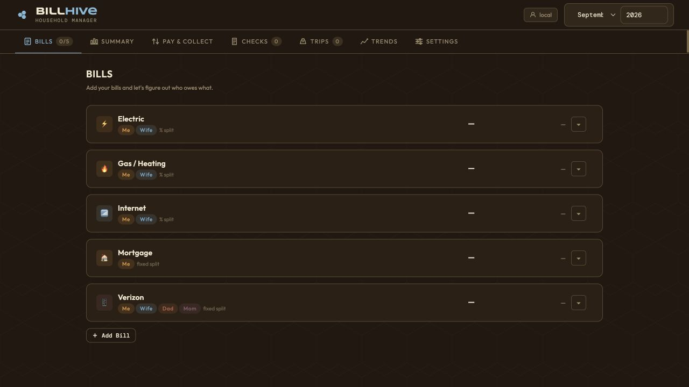
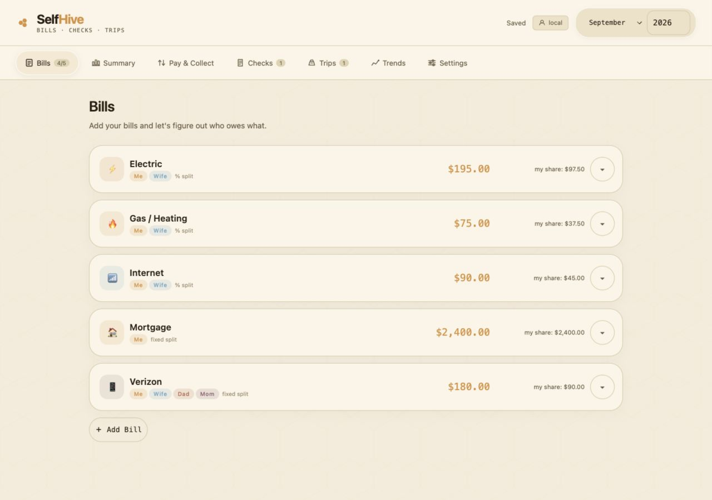
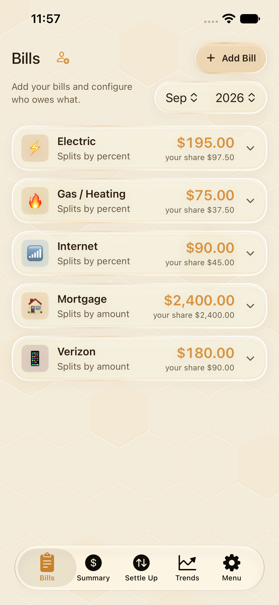

# SelfHive mobile → web parity review

Reviewed September 18, 2026. Changes are local and have not been deployed.

Reference: the current SelfHive target and shared BillHive sources at iOS commit `c3ff7a3`, including the September security remediation (`2936b70`), `Theme.swift`, persistence, authentication, backup and attachment code. Web baseline: `abc0313`. All implementation changes are in the independent `Web_App` repository; `iOS_App` remains unchanged.

## Result

The web app now uses SelfHive branding and the mobile app's honey, cream and cocoa visual language, with browser-appropriate translucent surfaces, rounded cards, pill navigation, native typography and accessible fallbacks. The review also found and fixed a protected-mode authentication bypass: an anonymous page visit could previously receive a host cookie that authorized subsequent API requests.

The other material changes bring the browser closer to the mobile remediation: acknowledged, serialized saves; visible recovery from failed saves; validation before imports and writes; account-bound pending work; safer attachment delivery; and honest reset/backup boundaries. This is a targeted parity and security review, not a comprehensive penetration test.

## Screens and flow

All screenshots below were captured during this review using synthetic data. Desktop captures are 1280 pixels wide and responsive captures are 390 × 844. Native captures are from the current SelfHive build on an iOS 27 simulator.

1. **Bills — improved and verified.** Honey surfaces and semantic text replace the old blue-accent dark interface. Expand controls have accessible names and 44-pixel button targets. Wide split tables retain their columns inside a labeled, keyboard-focusable horizontal scroll region. The add-bill dialog traps focus, supports Escape and restores focus. Native SelfHive successfully read the updated server and displayed the browser's saved Electric amount of $195.00.
2. **Summary — improved and verified.** Responsive cards stack on a narrow screen and use the shared color/type hierarchy. Synthetic household calculations rendered successfully. Long split tables still require horizontal scrolling on phones.
3. **Pay & Collect — improved and visually verified.** Collection and payment rows use consistent surfaces and touch targets. Synchronized text and payment URL attributes are escaped. No payment links were submitted and no email was sent.
4. **Checks — improved and functionally sampled.** Created a synthetic check and item in the browser; narrow-screen item editing rendered successfully. Form controls have explicit accessible labels. The capture records an intermediate pass before the final universal button-height adjustment.
5. **Trips — improved and functionally sampled.** Created a synthetic trip and expense, verified desktop editing, and confirmed native decoding of the resulting state. Member and expense fields use the common visual system and accessible names.
6. **Trends — improved and verified.** Line and category charts rendered with the updated palette. Historical values remain available as text; this does not establish complete screen-reader equivalence for every chart datum.
7. **Settings and access — improved and tested.** Light/dark/system selection has a visible selected state and accessible state. Accordion headings support keyboard activation. Web appearance survives mobile state updates. Server-wide authentication policy is restricted to configured administrators using a trusted browser session.

### Before and after

Original web interface:

Updated desktop Bills:

Current native SelfHive reading the updated server:

### Responsive and secondary screens

| Screen | Evidence |
| --- | --- |
| Bills on phone | [390-pixel Bills capture](screenshots/04-web-phone.png) |
| Summary on phone | [Summary capture](screenshots/05-summary-phone.png) |
| Checks on phone | [Check editor capture](screenshots/06-checks-phone.png) |
| Dark Settings | [Appearance and Settings capture](screenshots/07-settings-dark.png) |
| Trips | [Desktop trip editor](screenshots/09-trips-desktop.png) |
| Trends | [Charts and history](screenshots/10-trends-desktop.png) |
| Pay & Collect | [Collection and payment rows](screenshots/11-pay-collect-desktop.png) |

## Security and integrity changes

| Finding / mobile principle | Web implementation | Evidence |
| --- | --- | --- |
| Protected page visits minted host cookies | Anonymous protected requests no longer establish sessions; signed sessions require valid identity and expiry | Authentication regression test |
| Proxy logout or account switching could retain old access | Current proxy headers take precedence; proxy sessions require the upstream identity; browser writes carry expected user identity | Logout, precedence and account-switch tests |
| Device-key browser access needed a safe boundary | Key exchange creates an HttpOnly, SameSite=Lax session; revocation invalidates derived sessions; keys are not saved in browser storage | Exchange, revocation and policy tests |
| Cross-origin browser mutations | Origin and Fetch Metadata checks reject foreign writes while retaining native requests | CSRF and native compatibility test |
| Authentication configuration affected all users | `AUTH_ADMIN_USERS` controls policy changes; bearer/key-derived sessions cannot change policy | Admin and non-admin tests |
| Overlapping saves and false success | Immutable snapshots serialize; only successful responses acknowledge exact snapshots; failures remain pending with Retry save | Writer test plus offline browser recovery |
| Failed or stale loads could replace edits | Load and validate before replacing memory; defer refresh during edits/pending writes; reject account changes | Code review, browser edit/retry and API tests |
| Malformed imports and corrupt stored JSON | Shared structural validation; atomic rejected imports; errors instead of silent empty or partial backups | Import and corrupt-record tests |
| Synchronized values reached HTML attributes | Escape rendered names/descriptions/payment fields; validate identifiers and colors; reject prototype keys | Render-injection and contract tests |
| Uploaded files could become active page content | Reject unsafe path segments; user-scoped downloads; attachment disposition, octet-stream, nosniff and sandbox CSP | Download/path/isolation test |
| Broad inline script permission and private caching | Exact inline script hashes; no-store for private HTML/API/guest responses/downloads | CSP/hash/cache test |
| Email sanitization and TLS weaknesses | Explicit allowed attributes remove active handlers; SMTP requires TLS and certificate validation; file/URL content access disabled | Sanitizer and stubbed transport test |
| Misleading reset and backup scope | Atomic Clear Bill Setup revokes shares while preserving advertised history/files/credentials; reject imports with embedded attachment bytes | Reset and backup tests |
| Vulnerable runtime dependencies | Node 24, pinned current SQLite/Nodemailer/sanitize-html versions, committed lockfile and `npm ci` | Clean install and audit |

## Validation

- **15 automated tests passed**, zero failures: [captured output](test-results.txt). Run with Node 24 using `npm test`.
- `npm audit --omit=dev`: **0 known vulnerabilities** in the installed dependency tree. This is an advisory scan, not proof of absence of vulnerabilities.
- JavaScript syntax checks and `git diff --check` passed.
- A fresh `npm ci --omit=dev` succeeded in a separate directory assembled with the Docker file layout. Its server started and served `/`, both new JavaScript modules, `/share/test`, and `/api/health` successfully.
- **SelfHive simulator build succeeded**, then the installed app loaded the modified web server's state. The native screenshot shows the same $195.00 amount saved from the browser.
- Browser testing covered light/dark appearance, desktop/phone layouts, bills, summary, checks, trips, trends, settings and dialog keyboard behavior.
- With the local server stopped, a bill edit displayed **Not saved**. After restart and **Retry save**, the browser displayed **Saved** and an independent API read confirmed $195.00. This used only disposable local data.

## Deliberate platform differences and limits

Native Face ID, Keychain, app-switcher shielding, widgets and Watch privacy do not have direct equivalents in this ordinary web client. Browser protection relies on server authentication, secure deployment, session handling, no-store responses and avoiding local financial/credential storage. CSS translucency approximates the visual intent; it does not emulate Apple's native glass renderer. Reduced-motion, reduced-transparency, increased-contrast and forced-color fallbacks are included.

The server retains its whole-state synchronization model. Serialization prevents this browser's overlapping writes, but simultaneous edits from separate clients can still overwrite one another; server revision/conflict resolution is future work. Failed browser writes remain in memory and require the tab to remain open until Saved appears.

JSON exports are records-only. Attachment bytes, relay settings and device credentials require a complete server-volume backup. Import continues the existing merge behavior rather than claiming full replacement. Clear Bill Setup is not a complete account or server erasure.

No production proxy, TLS endpoint, SMTP relay, database or deployment was changed. No real email/payment was sent. Docker is unavailable on this Mac, so an actual Alpine container build remains unverified. Full Safari/Firefox, assistive-technology, physical-device, and every native-screen regression matrices were not run. Screenshots alone cannot establish accessibility compliance.

## Deployment checks

1. Back up the entire data volume, then build and test the Node 24 Docker image in the deployment environment.
2. Set `AUTH_ADMIN_USERS` to the exact administrator usernames used by the reverse proxy. Strip/overwrite all trusted identity headers and restrict direct backend access. `TRUST_PROXY` alone is not identity authentication. Empty `TRUSTED_AUTH_HEADERS` now disables header-based identity.
3. Expect older browser cookies to expire at upgrade; test proxy login/logout and device-key authentication. Preserve the public Host and forwarded protocol for origin validation and secure cookies. Default open local mode remains suitable only for a trusted, access-controlled deployment until authentication is configured.
4. Test the actual SMTP relay with certificate verification enabled. Configure `NODE_EXTRA_CA_CERTS` for a private CA instead of disabling TLS validation.
5. Smoke-test existing native clients, backups, downloads and guest links against the staged deployment before production rollout.

## Supporting references

The implementation was checked against primary guidance for [CSRF defenses](https://cheatsheetseries.owasp.org/cheatsheets/Cross-Site_Request_Forgery_Prevention_Cheat_Sheet.html), [file uploads](https://cheatsheetseries.owasp.org/cheatsheets/File_Upload_Cheat_Sheet.html), [HTTP security headers](https://cheatsheetseries.owasp.org/cheatsheets/HTTP_Headers_Cheat_Sheet.html), [Express proxy trust](https://expressjs.com/en/guide/behind-proxies/), [Nodemailer SMTP TLS](https://nodemailer.com/smtp), and the [Node release schedule](https://github.com/nodejs/Release).
